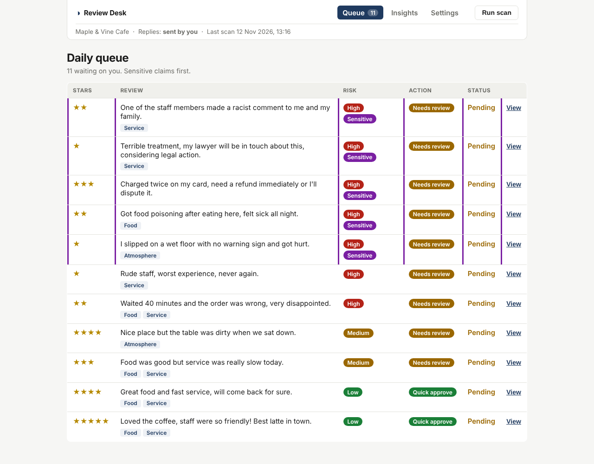
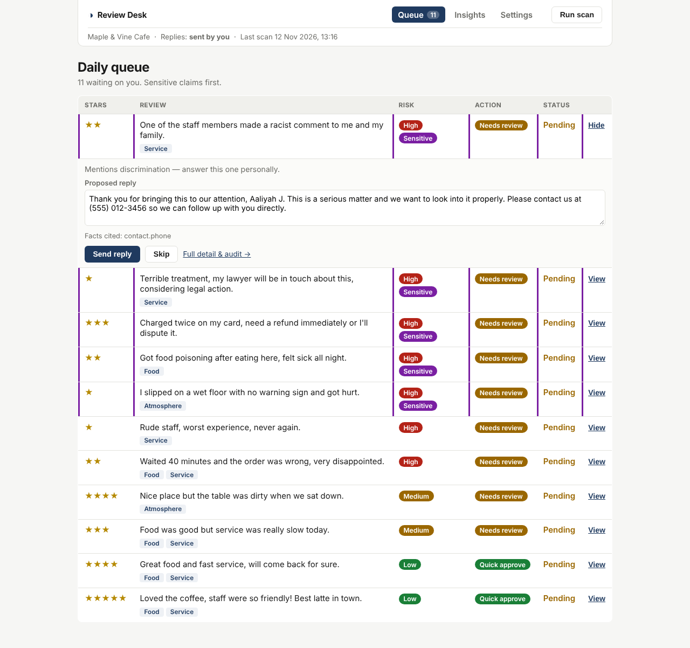
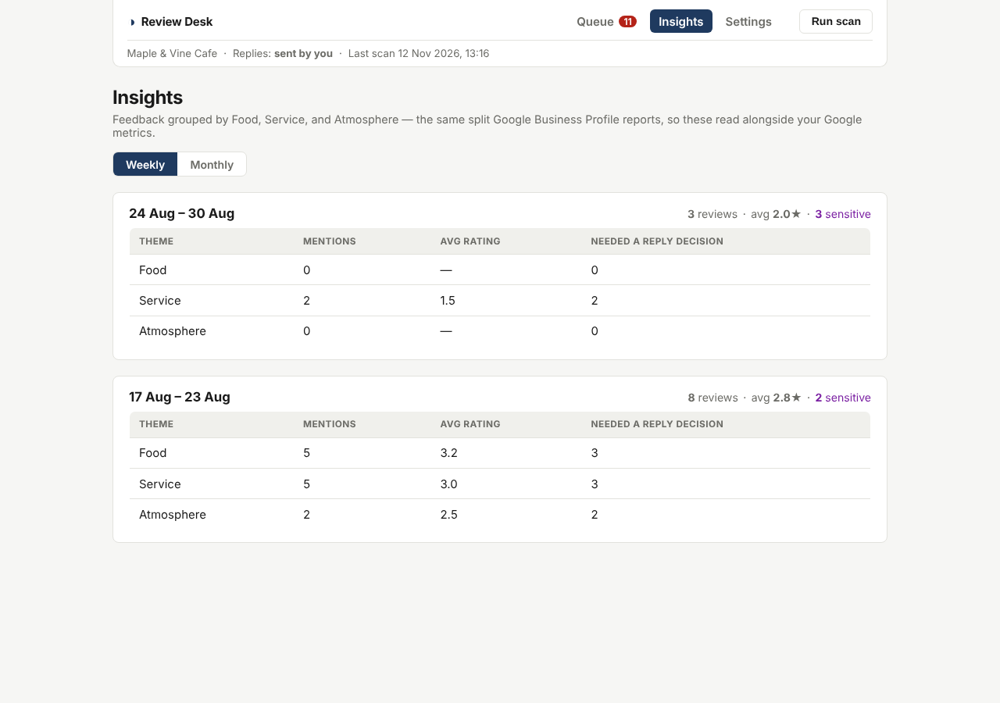
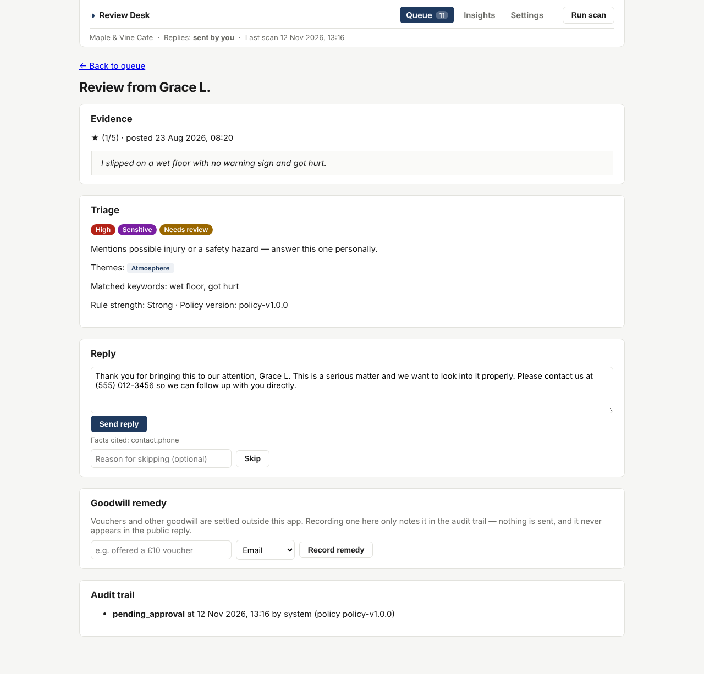

# Compliment-Complaint-Reviewer

A fixture-backed prototype for a governed daily review desk for Google Business Profile teams. It
demonstrates the narrow first workflow: scan new or updated reviews, classify risk, draft a
grounded response, and queue every reply for the owner to approve and send. Nothing is sent
automatically. Every send requires a factual-review confirmation and current source/draft versions.
The interface labels all sends as simulated.

See [verified-send controls and recovery](docs/VERIFIED_SEND.md) for failure states, acceptance evidence and remaining release gates.

## Current boundary

This prototype intentionally uses demo data. Google OAuth, the Business Profile API, email
approval, and MCP tools are the next integration layer. The backend worker — not MCP — will own
scheduling, idempotency, policy enforcement, and audit records.

See [SPEC.md](./SPEC.md) for the product boundary, non-goals, and production-shaped interfaces.

## Attribution

This is a fresh implementation inspired by the product scope and architecture of OpenReply. It
does not copy OpenReply source code and is not presented as a fork. If source code is reused in a
future version, retain OpenReply's MIT license and attribution.

## Hosted comparison demonstration

The same browser demo is prepared for Vercel, ChatGPT Sites and GitHub Pages.
Run `npm run build:comparison` to generate `comparison/dist`. See
[hosting status and comparison procedure](docs/HOSTING_COMPARISON.md).
Reviews are limited to the past six calendar months. Human decisions move items out
of Active into Completed; **No response required** is an explicit reviewed decision.
The hosted demo uses tab memory, with no external publication. Dataset 2 (the default)
contains five supplied real review-and-owner-reply pairs; Dataset 1 retains synthetic reviews.
See [Dataset 2 provenance, dates and classifier boundary](docs/DATASET_2.md).

## Client demonstration

Run `npm run demo` after installing dependencies, then open `http://127.0.0.1:3000/demo`.
Each launch creates a fresh, isolated synthetic queue. All sends remain simulated.
See [the five-minute walkthrough](docs/CLIENT_DEMO.md) for setup, reset behaviour and limits.
The local demo is not authenticated and must not be exposed publicly.

## Getting started

Requires Node.js >= 22.13.0.

```bash
npm install
npm run scan     # runs the daily worker over fixture data, populating data/store/*.json
npm run dev      # starts the Next.js dev server at http://localhost:3000
```

Open `/queue` to see the daily review queue — click **View** on any row to read the proposed
reply, edit it in place, and send it without leaving the page. `/insights` rolls the same
reviews up weekly or monthly by Food / Service / Atmosphere, and `/settings` shows the connected
location and how sending works.

### The daily queue

Sensitive claims sort to the top, marked with a purple rail. Risk, recommended action, status
and the Food / Service / Atmosphere themes all read at a glance.



### Replying without leaving the queue

**View** expands the row: the proposed reply is editable in place, the facts it cites are listed
beneath it, and the button reads "Send edited reply" once the text has changed.



### Insights

The same reviews, grouped weekly or monthly by the sub-ratings Google Business Profile already
collects, so they can be read against existing Google metrics.



### Review detail

Full evidence, the triage explanation and matched keywords, the draft with its cited facts, the
out-of-band remedy record, and the audit trail.



Screenshots are generated by `scripts/screenshots.mjs` — see [docs/screenshots/](docs/screenshots/).

## How it routes

Three risk levels, no escalation tier — a one-person team or an agency has nobody to escalate
to. Sensitive claims (safety, legal, discrimination, medical, fraud, compensation) are high
risk flagged `sensitive`: they are never offered as quick approve, at any star rating, and get
their own reply wording. Everything else follows the star bands, with complaint language pulling
a 4-5 star review down to "needs review".

Quick approve is **fail-closed**: a 4-5 star review only gets there when praise is present (not
just complaints absent), no reservation like "but" or "however" appears, and the text is
English the rules can read. Other languages, Singlish and praise-free text go to the owner.

**Nothing is sent automatically.** The owner sends every reply. Auto-send for deterministic
5-star positives is in the backlog behind a shadow-mode gate — see
[docs/DECISIONS.md](docs/DECISIONS.md), which also logs which decisions are easy to reverse and
which are not.

Terms match on word boundaries, and sensitive terms are split into strong and weak tiers — an
unambiguous claim goes straight to high, while an ambiguous one is softened to medium but is
still flagged sensitive. [SPEC.md](./SPEC.md) carries the full routing, grounding and theme
rubrics; `data/fixtures/golden.json` holds the labelled cases that hold them to it.

Goodwill remedies — vouchers and the like — are settled outside this app over email or
WhatsApp. The detail page records that one was offered so the audit trail is complete, but
nothing is sent from here and no remedy is ever mentioned in the published reply.

## CI & evaluation

The [current CI workflow](.github/workflows/ci.yml) runs TypeScript checks, unit and policy
tests (including deterministic golden routing cases), a production build, and a repeated-scan
check on pull requests. The verified-send change in
[PR #5](https://github.com/withJia-tech/Compliment-Complaint-Reviewer/pull/5) adds regression
coverage for stale approvals, edited replies, failed publication and uncertain delivery.

The separate, unmerged
[classifier branch](https://github.com/withJia-tech/Compliment-Complaint-Reviewer/tree/9e28eeefd02fcc26ed7b15d1b8961cabf1eca238)
adds expanded golden-set evaluation, adversarial fixtures, dependency and secret scanning,
and evaluation artifact uploads. Its required model-evaluation evidence is still outstanding.
Those checks are not part of this branch's workflow.

**Routing evals** ([evals/README.md](evals/README.md)) score the policy on a 60-case dev set and a
40-case holdout it was never tuned on: unsafe quick approvals, sensitive recall overall and per
category, false alarms, and how often the parked auto-send rule would have sent a review a person
must read. Ratchet gates run inside `npm test` and as a CI step that uploads the JSON report.
On the holdout, policy-v1.1.0 cut unsafe quick approvals from 15 to 5 but left sensitive recall
at 15%: keyword rules don't generalise to paraphrased claims, which is the case for a classifier.

A **promotion gate** (backlog B8) fails the build when the routing source changes without a
`POLICY_VERSION` bump; `npm run policy:stamp` refuses to stamp until the version is bumped.

Semantic grounding coverage and broader policy-compliance gates remain planned. Template and
send-boundary tests do not establish semantic grounding coverage or live-model prompt-injection
robustness.

There is no standalone lint job yet.
Passing CI establishes the checks implemented for that revision; it does not establish
production readiness. See [verification limits](docs/VERIFIED_SEND.md) for remaining release gates.

## Scripts

| Command | Description |
| --- | --- |
| `npm run dev` | Start the Next.js dev server |
| `npm run build` | Production build |
| `npm run start` | Run the production build |
| `npm run scan` | Run the daily scan CLI over fixture reviews (re-runnable/idempotent) |
| `npm test` | Run the Vitest suite, including golden routing, eval gates and the policy promotion gate |
| `npm run eval` | Score routing on the dev and holdout sets; fail on a breached gate; write `evals/reports/latest.json` |
| `npm run policy:stamp` | Record the routing source hash for the current `POLICY_VERSION` (refuses if unbumped) |
| `npm run typecheck` | Type-check the project with `tsc --noEmit` |

## Architecture

- `lib/interfaces/` — production-shaped contracts (`ReviewProvider`, `TriagePolicy`,
  `ReplyDrafter`, `ApprovalChannel`) with no implementation, so a real Google/email/MCP
  integration can be swapped in later without touching callers.
- `lib/providers/`, `lib/drafter/`, `lib/approval/` — the one fixture/stub implementation of each
  interface used by this prototype.
- `lib/triage/` — the deterministic `DefaultTriagePolicy`: star bands, complaint-keyword
  downgrades, sensitive-claim detection that always routes to a human, and Food / Service /
  Atmosphere theme tagging.
- `lib/insights/aggregate.ts` — weekly and monthly rollups over reviews already in the store.
- `lib/decisions.ts` — send / skip / record-remedy, shared by the queue's inline actions and
  the detail page so both write identical approval and audit records.
- `lib/store/` — a JSON-file-backed repository layer (`data/store/*.json`) with atomic writes;
  swapping to a real database later means reimplementing the repos only.
- `lib/scan/runDailyScan.ts` — the single orchestration function shared by the CLI script
  (`scripts/dailyScan.ts`) and the optional `POST /api/scan` route.
- `app/queue`, `app/review/[id]`, `app/settings` — the reviewer-facing UI.
- `data/fixtures/` — seed reviews (spanning every risk band and escalation category) and the
  approved business facts the drafter is allowed to cite.
