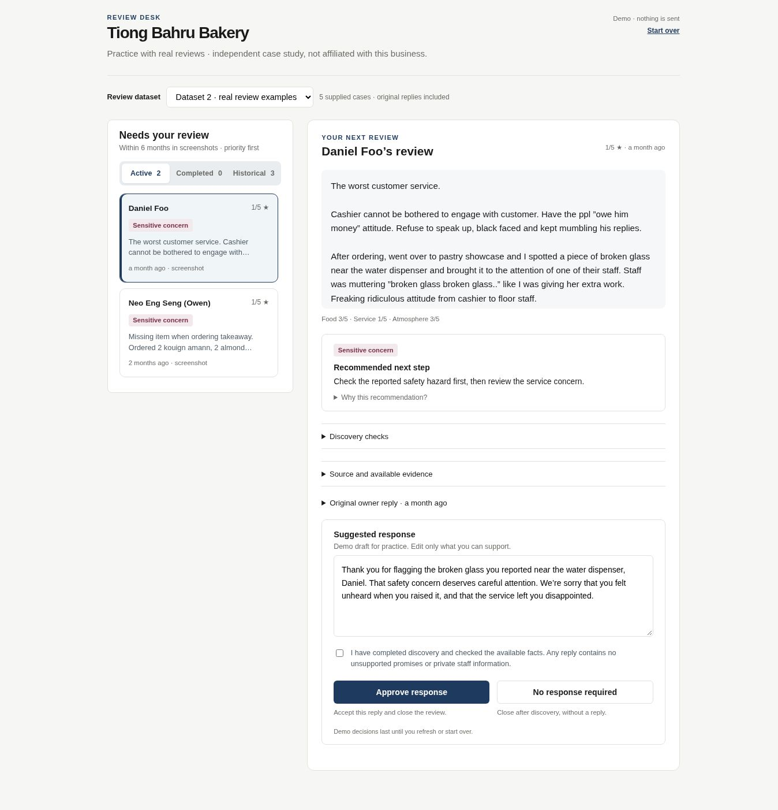

# Dataset 2 — supplied real review examples

The default hosted demo now uses five customer reviews and five existing owner replies
from the ten screenshots supplied on 13 November 2026. All five cases name Tiong Bahru
Bakery; this is an independent demonstration, not an affiliated or authorised owner account.
Dataset 1 remains available through the dataset selector.

## Source and trust boundaries

`data/demo/dataset2.json` contains transcribed text, displayed ratings and age labels,
paired source filenames and SHA-256 hashes. Whitespace and line wrapping are normalised.
Screenshots, profile photographs, receipt details, reviewer history and Local Guide status
are not shipped with the demo. No reviews are fetched from Google in this change.

Customer accounts, existing owner replies and new demonstration drafts remain separate.
An owner reply is neither an approved business policy nor proof that an investigation,
remedy or operational fix happened. Its historical contact information is plain reference
text; it is not copied into the new drafts or turned into a live recovery link. The demo
has no approved facts or publishing authority for this business. New drafts are authored
examples, not output from a connected language model. Up to three internal discovery
checks retain disputed claims and missing evidence.

## Time window

| Case | Age visible in screenshot | Demo placement |
| --- | --- | --- |
| Daniel Foo | a month ago | Active practice case |
| Neo Eng Seng (Owen) | 2 months ago | Active practice case |
| PS M | a year ago | Historical, read only |
| Lind Vic | Edited a year ago | Historical, read only |
| Dwayne Leong | 2 years ago | Historical, read only |

The screenshot capture date and exact original publication dates are unknown. Relative
age labels are preserved verbatim; no fabricated ISO creation times are assigned. The two
recent examples form a practice cohort based on the displayed ages, not a claim that they
are currently pending or within six months today. Existing replies are included for each.
Edited dates alone cannot establish recent original publication. The operational intake
continues to require the original date and enforce its existing rolling six-month cutoff.

## Classifier finding and controlled candidate

The production keyword classifier misses “broken glass” as a sensitive safety signal.
Dataset 2 uses `demo-candidate-v1.1.0`, which adds that phrase as a high-risk safety trigger.
The default production `policy-v1.0.0` and its thresholds are unchanged. The classifier
interface now accepts only id, stars and review text: absent dates need not be invented,
and owner replies, names, profile status and metadata are not classification evidence.

Targeted regression cases verify the safety phrase even at five stars, the missing-items
refund request, separation from owner-reply content, source/date provenance, historical
exclusion, dataset isolation and wording validation. This small demonstration set is not
a representative evaluation dataset or sufficient evidence to promote the candidate.
A production promotion still requires the frozen evaluation gates and explicit decision.

## Workflow

The default active queue contains Daniel and Neo, with the reported safety issue first.
Open the original owner reply to compare it with the demonstration draft. Review discovery
checks, then approve the draft or choose No response required. Either deliberate decision
moves the case into Completed for this browser session. Historical cases remain read only.
Switching datasets preserves independent session decisions; Start over resets both.

## Validation and delivery

152 tests pass, including seven Dataset 2 boundary and classification cases. TypeScript,
the comparison bundle and the Next.js production build pass. Browser checks covered the
original-owner-reply display, discovery confirmation, no-response closure, read-only
historical cases and independent decisions when switching datasets. The Vercel deployment
`dpl_GDqbnC2wNLxNGhumujTeGHEauG4i` was browser-verified with Dataset 2 selected by default.

Public GitHub publication initially paused for confirmation to include the supplied
customer names, review text and owner replies. The user confirmed that concrete disclosure
request by asking to resume. The same GitHub connector then accepted the update.
The Pages artifact is commit `c75f0c53ffdb51fcf07365a9cce700ad8ce2942e`; its deployment
completed successfully and the live page was browser-verified, including no-response
closure and automatic selection of the next case. The source changes are tracked in PR #5.

