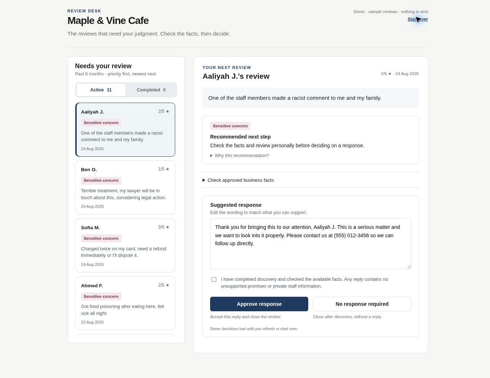
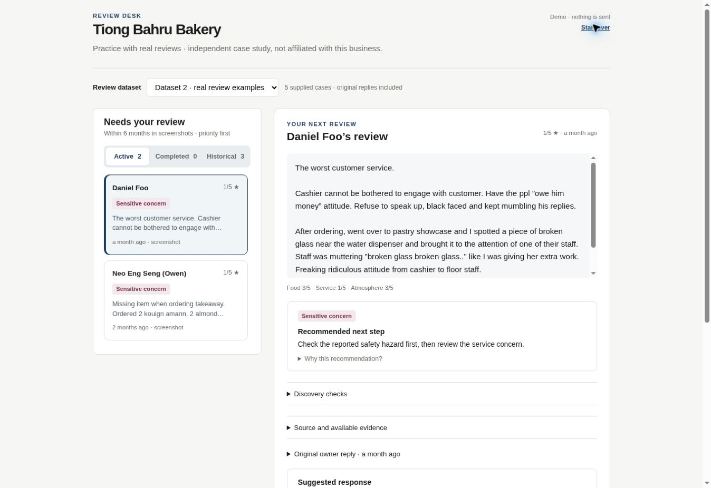

# Review desk: hosting comparison

This comparison deploys one self-contained browser application, generated by
`npm run build:comparison`, to all three targets. `comparison/dist/build.json`
records its content digest, frozen cohort date and case count; provenance is kept
outside the customer interface. Dataset 1 contains 11 synthetic reviews from the six months ending 13 November 2026.
Dataset 2 is the default and contains five supplied screenshot cases, split into two recent
practice cases and three read-only historical cases; exact source dates are unknown. See
[Dataset 2](DATASET_2.md). The real intake path uses a rolling cutoff.

## Product behaviour

- Active shows undecided reviews, sensitive/risk priority first and newest within each band.
- The workspace explains the recommendation, provides the original review and approved facts,
  and lets the reviewer edit a proposed response.
- Approve response accepts the checked wording and closes the demo review.
- No response required records a deliberate decision after discovery and closes the review.
- Both decisions move the item to Completed; refreshing or starting over resets the demo.
- A compact demo label states that no reply is sent. Build identifiers, test controls,
  internal activity logs and implementation notes do not appear in the client interface.

The server-backed local prototype also records no-response decisions with actor,
context version, timestamp and audit entry, without calling the publication provider.
It refuses missing confirmation, stale evidence, repeated decisions and unresolved sends.
Unknown/in-progress delivery stays in the active operational queue until reconciled.

## Targets and current access

| Target | Address or source | Status |
| --- | --- | --- |
| Vercel | https://compliment-complaint-demo.vercel.app/ | Public production demo alias |
| ChatGPT Sites | https://compliment-review-desk-compare.jia2lian7.chatgpt.site/ | Deployed, owner-private; ChatGPT sign-in gate |
| GitHub Pages | https://withjia-tech.github.io/Compliment-Complaint-Reviewer/ | Public demo; Dataset 2 deployment and decision flow verified |

Pages is enabled and deploys from the `gh-pages` branch. Its Dataset 2 deployment succeeded
on 13 November 2026. The earlier activation blocker is resolved; this verification used
the public demo and GitHub deployment results without retrying browser authentication.

## Fair comparison

Use the same device/browser, start each site afresh, and confirm its build.json digest.
Try opening a high-priority review, checking the recommendation/facts, marking a positive
review No response required, and finding it in Completed. Compare ease of access,
queue/workspace navigation, text readability, action clarity and load responsiveness.
Do not infer a speed ranking from one load or from a sign-in gate.

The application layout, classification and decision behaviour are the same artifact.
The observed access difference comes from the configured audience: Vercel and Pages are
public; Sites is owner-private. Mobile usability and
cross-host performance need the user's device comparison; no benchmark is claimed.

## Production boundary

These hosts serve a tab-memory demonstration containing synthetic and supplied real review
examples. No customer reviews have been retrieved through a live Google integration. Google authorization, authenticated business-owner roles, durable state,
real publication/reconciliation and operational support remain release requirements.
The static comparison does not exercise server actions or store concurrency. The local
Next.js prototype retains its own checks and is not suitable for public live use.

## Previous build verification — 13 November 2026 (before Dataset 2)

- 145 automated tests passed; TypeScript check and Next.js production build passed.
- Browser verified the Vercel screen, discovery refusal, explicit no-response decision,
  Active count reduction, next-item selection, Completed record and reset.
- Final Vercel deployment: `dpl_3oZEiw1FMcMAYoghLiZ8MbhqYvMP` (READY).
- Final Sites deployment: `appgdep_6af6a9a925e88191b6c2fe53c5aca407` (succeeded).
- Sites source: `67380f4805bc32891d9afb9f86c5f03550ec788b`.
- Pages artifact commit: `165db2f53d759f5fa3e67bfabf21940730eb7101`.
- Bundle digest: `bb042382b1af3fa2180e1aa2a298b20cc0fca581b370fdb2b254b7401172a412`.
- Sites browser observation: ChatGPT sign-in required; no in-app UX comparison claimed.
- At that checkpoint Pages had not yet been verified; see the updated verification below.

## Dataset 2 verification — 13 November 2026

- 152 automated tests passed, including seven Dataset 2 boundary cases. TypeScript and
  Next.js production build passed; the final static bundle was rebuilt successfully.
- Vercel deployment: `dpl_GDqbnC2wNLxNGhumujTeGHEauG4i` (READY, browser-verified).
- Sites deployment: `appgdep_6af6ae89090081919173476bcdf194c5` (succeeded, owner-private).
- Sites source: `6a2fc69f1130357c70e12efdaa2db3f869afdee7`.
- Pages artifact: `c75f0c53ffdb51fcf07365a9cce700ad8ce2942e`.
- Pages workflow: https://github.com/withJia-tech/Compliment-Complaint-Reviewer/actions/runs/43381046712
  (completed successfully).
- Bundle digest: `d902c2560084ce103c60e5c63d3e9630bc4038b1a2427760dbe87fca3865a740`;
  Pages `build.json` matches the artifact deployed to Vercel and Sites.
- Browser-verified Pages: Dataset 2 default, two active and three historical cases,
  discovery-confirmed No response required moves Daniel to Completed and selects Neo;
  Start over restores the two active cases.
- No cross-host speed benchmark or live production readiness is claimed.

