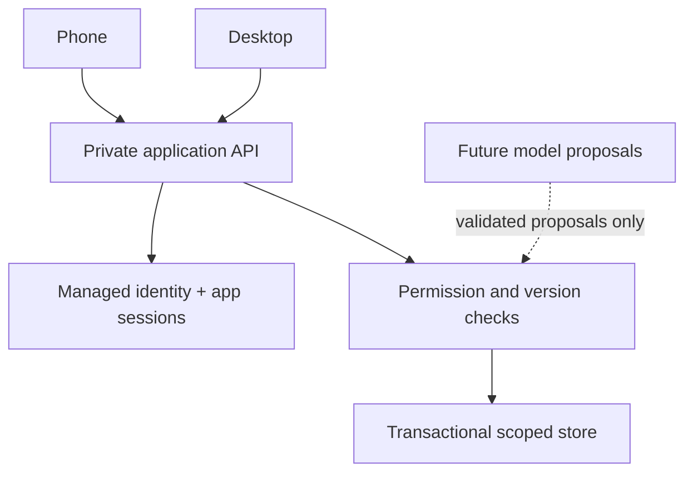

# Private pilot: authentication, storage and recovery

19 November 2026 — proposed design, not an architecture approval or deployed capability.

**Recommendation for approval:** one private pilot application using managed authentication and a transactional Postgres store, with independent sessions for the same owner on phone and desktop. Supabase Auth + Postgres is the concrete managed option evaluated here. Public comparison demos remain separate and read-only at the server boundary. No provider, account, paid plan, region or new integration has been selected or provisioned.

The product direction is already settled: one owner, two existing datasets, saved drafts, scoped owner-approved facts and reviewable interpretation corrections. This document resolves the proposed mechanisms and tradeoffs against [PM-01–PM-10](PILOT_MEMORY_POLICY.md). ADR-001 remains open on operating ownership, future tenancy and distribution.

## 1. Inspected baseline and actual gaps

Inspected current GitHub refs: main `cfe0daf7473a54c04fb54d53f14c746cce2b5b3b`; PR #7 `5d0cb9f1f32678327210bbad82b8f402bfa3d40b`; PR #11 `6420809a4c04ccbb0a332d42c0740a1ab917bc21`. Both PRs remain open drafts. This design branches from compatibility candidate `5fe6ec9fde39fc9218becf4448ec9feee6251b8c`. Its two workload evaluation failures are unchanged, not resolved by persistence work.

| Observed source | Current behaviour | Proposed addition |
|---|---|---|
| `app/hosted-demo/sandbox.tsx` | React state holds drafts and simulated outcomes | Private authenticated editor loads/saves a versioned draft; public sandbox remains separate |
| `lib/demo/hosting.ts`, `middleware.ts` | `VERCEL=1` or demo flag blocks writes and operational routes | Explicit deployment modes; do not simply remove this guard to activate a private pilot |
| `lib/types.ts`, `lib/store/*Repo.ts` | Stub owner, records primarily keyed by review ID | Server-resolved principal and business/dataset/case scope |
| `lib/store/jsonStore.ts` | Atomic replacement per file and local writer lock | One transaction for draft head, revision, event and retry receipt |
| `lib/approval/context.ts` | Context hash is freshness evidence, explicitly not identity | Separate authentication; versioned dependency contract and compare-and-swap |
| `ApprovedBusinessFact` | No approval lifecycle, expiry or fact-version record | Owner-approved fact versions; incident accounts and interpretation candidates kept separate |

The v0.7 pack's H0–H5 contract is a design source, not an implemented pipeline. This slice supplies state and identity boundaries for those future handoffs. It does not choose a model, resolve interpretation policy, implement publishing or migrate historical fixture approvals into trusted production approvals.

## 2. Architecture options and operating tradeoff

| Option | Cross-device suitability | Operational responsibility / tradeoff | Position |
|---|---|---|---|
| Managed identity + Postgres, one private pilot project | Shared committed state; supports transactions and recovery | Provider operates infrastructure; app operator still owns permissions, migrations, incidents and restore drills | Recommended candidate for this pilot |
| Dedicated managed project per restaurant | Same contracts; stronger infrastructure separation | More projects, rollout work and recurring cost as customers grow | A future tenancy option; for one pilot it may look identical to the first option |
| Restaurant-operated server + Postgres/identity | Works if both devices can securely reach it | Restaurant or its IT partner owns patching, access, backups, uptime and support | Choose only when a capable operator actually accepts that role |
| Browser-only storage | No shared authoritative draft between devices | Cheap, but clearing/eviction and device isolation remain | Insufficient for the accepted cross-device requirement |

SQL records and application-owned identifiers reduce data migration cost. Identity accounts, email flows, backup tooling and operational processes still create provider dependencies. No claim of effortless provider portability. Multi-restaurant SaaS is not being selected by proposing one shared store for one owner's devices.

All private traffic uses one application origin. Proposed deployment modes are `public_demo`, `private_pilot` and `local_fixture`. Missing/invalid production configuration fails closed for writes. `private_pilot` additionally requires configured identity, storage and membership enforcement. This needs a scoped future change to the existing blanket Vercel guard, with all public-demo denial tests retained. The public demos receive no private API keys, cookies, owner facts or saved drafts. The companion can remain a public read-only page; returning to the private app resolves the saved case after authentication. A link contains only an opaque case reference, never draft text, tokens or personal data; use a no-referrer policy when leaving the private application. The private return flow must load the authorised case from durable state, not rely on `window.opener`, browser Back caching or a surviving original tab. The public companion must not offer an open redirect or display arbitrary untrusted return URLs.

## 3. Authentication and authorisation proposal

**Identity choice:** invite-only email one-time code for the first pilot, through managed auth. It lets the owner enter a code on the device where they started sign-in. Google sign-in is a viable alternative if preferred; it must not imply Google Business Profile access or publishing permission. No login method is implemented by this document.

Provision the one owner through an operator-controlled enrolment process. Turn off self-registration, configure OTP not to create users, and independently require an active application membership. Unknown email requests receive the same generic response. Email delivery, verified sender/domain, throttling and recovery setup are prerequisites. A shared restaurant inbox is unsuitable as proof of a particular person's decisions. Passwordless email is not phishing-resistant and depends on inbox security.

The application maps verified provider issuer + subject to its own owner ID. Never use reviewer names, a request-body owner ID or editable auth metadata as authority. Authorisation checks membership and scope on **every read, write and retry-receipt lookup**, including direct URLs. Use uniform not-found responses for inaccessible cases. The two datasets can have distinct business scopes: fixture business facts must not become approved facts for the real-review case study.

**Session proposal:** a backend-for-frontend owns encrypted provider tokens; browsers receive an opaque, random `__Host-ccr_session` cookie (`Secure`, `HttpOnly`, `SameSite=Lax`, `Path=/`, no Domain). No refresh token in localStorage or IndexedDB. App-session rows hold a token hash, owner, device label, expiry and revocation status. This is a proposed server session layer, not an assertion that a default provider SDK supplies it. All endpoints require HTTPS, private/no-store responses, Origin/CSRF checks for mutations and validated redirect targets. Cookie protection does not eliminate XSS; no raw HTML rendering or private response caching is permitted.

Keep phone and desktop sessions independent: ordinary sign-out revokes this device; “sign out all devices” is explicit. Propose seven-day absolute and 24-hour idle limits, enforced by the app on each request; reauthentication preserves the edit buffer and requires an explicit retry. More than one active session must be allowed. Recheck revocation in the application rather than assuming a previously issued JWT expires immediately after sign-out. Identity validation outages fail closed for new operations while the unsent text remains visible locally. Privileged account changes, export/delete and future fact/decision approval require recent authentication and enrolled MFA; exact UX and recovery mechanism need adapter testing.

Lost-phone recovery revokes that app session immediately and the corresponding provider session where supported. A server cannot remotely erase an offline browser cache. Lost-inbox recovery requires a pre-established recovery method or a documented operator verification process; no reassignment based on matching names or a support assertion alone. No live owner account should depend on an undefined recovery operator.

## 4. Data ownership and minimum records

One store does not mean one undifferentiated memory collection. Every case record is scoped by `(workspace, business, dataset, case)`; record IDs alone never grant access. Enforce matching composite foreign keys, unique constraints and row-level scope checks. The app supplies scope only after membership validation. Proposed Postgres adapters use a restricted non-owner role without BYPASSRLS and FORCE RLS on application tables; server-verified scope is set transaction-locally. The database must not be exposed using a privileged service key to browser clients. Migrations/admin credentials are separate. RLS and pooled-connection scope reset require real database tests, not this model.

| Record | Required fields / lifecycle | Access and meaning |
|---|---|---|
| Workspace memberships and app sessions | Internal owner ID, permitted business/dataset scope, status; session expiry/revocation | Application-managed; no model write path |
| Case source reference | Scoped case ID, source version/hash, dataset version, provenance | Existing fixture bundle referenced; no automatic new archive of live reviews |
| Draft original + revisions | Distinguish owner-submitted original, template/model proposals and later owner saves; exact text/hash, immutable version ID, parent version, actor, server time | Save never changes approval or external outcome; generated text must not be mislabelled owner-authored |
| Draft head | Current immutable version ID, display revision, dependency snapshot, restore epoch | Conditional update only; no last-write-wins fallback |
| Business fact versions | Scope, fact ID/version, source, approving owner, effective date, expiry/review date, active/withdrawn/superseded state | Only applicable approved versions reused; an owner assertion is not automatically independent verification |
| Incident context | Scoped case, attributed account, source/version, dispute/unknown flags | Case-specific; identifiable staff material excluded from this pilot and from model context |
| Interpretation correction | Excerpt reference, owner explanation, uncertainty/counterexamples, source/policy version, candidate/reviewed/rejected state | Candidate only; cannot alter routing, prompts or approved facts |
| Local approval record (future H5) | Exact draft/dependency versions, verified owner, attestations, `external_action=none` | Separate command, validation and transaction; historical record remains even if no longer current |
| Save receipt and audit event | Scoped request ID + request hash, committed version, actor, time, outcome; no raw text in operational logs | Same transaction as the draft write; duplicate retry cannot create a second event |

Draft/context text can itself contain personal information. Masked reviewer names do not make review text anonymous. No new model egress, cross-business learning or long-term live-review archive follows from approving draft storage.

**Retention proposal for approval:** opt-in local recovery buffers up to 24 hours; abandoned draft/case working state deleted after 30 days of inactivity unless deliberately retained; owner-approved business facts retained while active and reviewed every 90 days where no earlier expiry applies; unpromoted correction candidates reviewed or deleted after 30 days; retry receipts 30 days; minimal audit metadata 90 days. These are product defaults for discussion, not legal retention advice or existing settings. A save of identical content must not silently extend every retention deadline. Deletion includes revision text and derived context; restore operations must reapply a separately protected deletion ledger before reopening access. Backup expiry is disclosed, and retained audit metadata must not keep recoverable personal text or unsalted low-entropy text hashes indefinitely.

## 5. Save/load contract and concurrency

The proposed API contracts are specified in [PILOT_MEMORY_API_CONTRACT.md](PILOT_MEMORY_API_CONTRACT.md). A save accepts text, expected immutable draft version, expected dependency version, restore epoch and an idempotency key. Actor and permission are server-resolved. Structural draft validation allows incomplete wording; public-reply validation and approval are separate. Proposed draft cap is the current UI's 4,000 UTF-16 code units, with a 32 KiB HTTP body cap; v0.7's different proposed draft cap must be reconciled explicitly at implementation, not presented as a platform limit.

Save transaction: authenticate and authorise → check current restore epoch → serialise on the scoped case/head and scoped request key → return matching receipt or reject reused key with changed payload → compare draft/dependency versions → append revision, update head, append event and save receipt → commit → acknowledge. Never hold the database transaction open across an auth-provider/model/network call. Recheck the session/membership state inside the transaction before writing so revocation cannot be bypassed by a delayed request. Use one consistent lock order for case dependencies and fact updates to avoid races/deadlocks; retry aborted transactions only under the same request key.

Postgres conditional updates/row locks or serializable transactions can implement this. A read followed by an unconditional write cannot. The new adapter must demonstrate real two-connection races and rollback; the in-memory model only expresses the intended ordering.

The editor serialises its own save queue. If the owner types while a save is pending, keep the newer buffer. An old acknowledgement cannot replace it or mark the newer text saved. Version IDs are opaque; display revision numbers help users but are not identity. A replay returns the original committed receipt plus the current head version, so an old success cannot revive an obsolete draft or approval.

## 6. Recovery behaviour and honest status

| Situation | Application behaviour | Owner sees |
|---|---|---|
| Awaiting commit | Keep input buffer; no success before acknowledgement | Saving… |
| Response lost after a possible commit | Look up/retry same request key; do not invent a new save | Checking whether your draft was saved |
| Concurrent edit | Return conflict and latest permitted head; preserve both texts for explicit reconciliation | This review changed on your other device |
| Source/fact/policy change | Preserve text but reject obsolete context; require review against current inputs | The evidence changed; check it before continuing |
| Offline or expired session | Keep working buffer; retry only after connection/auth and version checks | Not synced; only on this device if local write succeeded |
| Browser reload/companion return | Authenticated load of committed head; compare optional local recovery copy | Saved draft restored, or a visible unsynced copy to reconcile |
| Device loss | Other device retrieves committed head only | Unsynced work from the lost device may be unavailable |
| Database restore | Maintenance mode, new restore epoch, revoked sessions, approvals stale; old queues cannot replay | Service recovered; sign in and review recovered work |

Propose an **opt-in trusted-device recovery journal** in IndexedDB containing only the draft, scope, expected versions and request ID. No session tokens, entire review archive or private staff records. A successful local write earns “On this device”; a database acknowledgement earns “Saved”. Local storage can fail or be evicted, and unsaved keystrokes before the local write can be lost. Do not guarantee recovery after tab eviction, clearing browser data or device loss. Bind buffers to verified owner and scope; do not reveal them to a different signed-in account. Clear on sign-out/expiry under the stated policy, with a visible warning before discarding unsynced work. Local encryption alone would not solve same-origin XSS. No browser implementation is included here.

**Database disaster recovery proposal:** distinguish ordinary save/retry recovery from provider backup recovery. Budget pilot: daily backup, proposed maximum-loss target (RPO) 24 hours and restoration target (RTO) one business day; suitable only if losing a day's saved pilot work is explicitly acceptable. Stronger option: PITR plus a measured target RPO ≤15 minutes/RTO ≤4 hours. Neither target is a promise until restore drills pass. Alert on backup age exceeding the selected target; a failed backup breaks the target.

Restore runbook: stop writes and capture the incident boundary; restore to an isolated target first; validate scope, revision/receipt/event consistency and deleted-data suppression; replace custom database credentials and recover separately managed secrets; issue a **new restore epoch from a control plane outside the restored snapshot** and store it in the restored database before enabling traffic; revoke app sessions; mark/re-evaluate approvals as stale; run isolation and replay checks; record actual lost commits and elapsed time; reopen only after the operator accepts the result. No queued approval, correction promotion or external send is replayed. Restoring old rows does not authorise resurrecting withdrawn facts or prior approvals.

## 7. Authentication/storage costs and decision needed

Official pricing checked 19 November 2026 lists Supabase Pro from **US$25/month**, with daily backups retained seven days. PITR starts around **US$100/month extra** for seven-day retention. Thus the stronger option has a **US$125/month starting subtotal**, before application hosting, email, extra compute/usage, taxes and operator time. It is not an all-in quote. The free plan is an experiment option, with no included automatic backups and inactivity pausing; it does not meet the proposed durable pilot recovery budget. [Pricing](https://supabase.com/pricing).

The important small-business tradeoff is what loss of work is acceptable, not whether the database can store a few drafts. For repeatable example-data validation, the daily-backup option is a reasonable proposal. For important daily owner work, do not accept a 24-hour loss window merely to save the PITR cost. Choose the recovery target and obtain the full hosting/email quote before provisioning. Region, operational owner, trusted-device retention and account recovery must also be confirmed before real data is stored.

## 8. Acceptance map and measured limits

Run the bounded synthetic model with `node --test design/pilot-memory/scenarios.mjs`. It has no identity provider, HTTP server, browser, database or external write capability. These are **model checks**, not production acceptance passes.

| Check | Contract evidence exercised | Still required on actual implementation |
|---|---|---|
| PM-01 | Another synthetic session reads exact saved text/version and original | Phone + desktop sessions against shared DB |
| PM-02 | Stale version is rejected, both texts retained | Two real DB connections, UI reconciliation, out-of-order responses |
| PM-03 | Before-commit failure is atomic; lost acknowledgement replays safely; old receipt identifies newer head | Transport interruption, IDB failure/eviction, offline and reload paths |
| PM-04 | Same key replays once; changed payload conflicts | Unique constraints, concurrent retry race, receipt-retention boundary |
| PM-05 | Membership, dataset, session expiry and per-device revocation | Verified identity, JWT/CSRF tests, real RLS and pooled-connection isolation |
| PM-06 | Only applicable approved/unexpired facts enter context | Fact approval and withdrawal UI plus database permission tests |
| PM-07 | Draft/source/policy changes and fact expiry invalidate current approval; history retained | Complete H0–H5 dependency snapshot and atomic H5 transaction |
| PM-08 | Correction stays a candidate and cannot alter facts/policy | Human review workflow, frozen semantic evaluation and explicit promotion |
| PM-09 | No browser simulation claim | Real companion return, Back, narrow layouts, reload, mobile lifecycle |
| PM-10 | Save rejects caller authority, model principal cannot write, save emits only draft event | Route capability isolation and zero-publish integration spy with real adapter |
| Recovery addition | New restore epoch rejects old queues/approvals | Actual backup/restore, deletion replay, credential and session recovery drill |

The initial model run passed 17/18. Its phone and desktop fixtures shared an object reference, causing revocation of one to revoke both. Separate session records corrected the model; **the final model run passed 18/18, with no skips**. Three deliberate model mutations—removing the version check, allowing state change before failed commit, and removing restore-epoch rejection—each caused 1 failure / 17 passes. All three guards were therefore detected by these tests. Results are recorded in [the evidence folder](evidence/pilot-memory-design-20261119/). This was a model defect, not a discovered production auth bug. No PM item is marked end-to-end verified. Production source, package dependencies, public build outputs and routing expectations remain unchanged.

Measure the implementation using request/run IDs and scope-safe identifiers: committed saves/valid attempts, ambiguous outcomes/all save attempts, conflicts/stale attempts, duplicate events/replayed requests, unauthorised successes/denied attempts, cross-device exact restores/completed saves, stale approvals accepted/stale attempts, and external calls from save paths. Safety assertions require zero observed violations with denominators; a small passing set is not a population guarantee. Proposed usability targets: p95 acknowledged save ≤2 seconds and foreground resume ≤3 seconds on a defined network/workload. No latency results exist yet. Never put draft text, OTPs, tokens or private accounts into operational logs.

## 9. Implementation slices after the design decision

1. Review this design independently; its branch inherits the unmerged compatibility candidate and must not be merged wholesale as a shortcut. Freeze the operating/recovery choice, scope identifiers, retention and HTTP contracts. Start synthetic-only. This is a separate design branch; do not merge the compatibility candidate while its two evaluation gates fail.
2. Add an auth/session adapter and membership enforcement; test both devices, expiry/revocation and negative access. No model integration.
3. Add one transactional save/load adapter with revision/event/receipt records; test two-connection races, rollback, acknowledgement loss and restore epoch.
4. Wire a private editor to those contracts; keep the public demo restrictions. Add opt-in recovery journal and execute PM-01–PM-05/09/10 on mobile and desktop.
5. Add versioned fact and correction records; test PM-06–PM-08. Implement local-only H5 separately; never call existing fixture publishing from this path.
6. Run the real restore drill and deletion checks, then evaluate pilot usefulness and workload. Automated learning, live Google intake and public publishing require separate scope decisions.

## Primary references checked

- [Managed auth sessions](https://supabase.com/docs/guides/auth/sessions) and [sign-out scopes](https://supabase.com/docs/guides/auth/signout): multiple sessions and token expiry need deliberate handling. The proposed opaque app-session layer is our design, not a provider default.
- [Email OTP](https://supabase.com/docs/guides/auth/auth-email-passwordless): control user creation and configure the code email flow. Application membership remains a separate check.
- [Postgres row-level security](https://supabase.com/docs/guides/database/postgres/row-level-security): privileged service roles can bypass RLS; the runtime must not use that as its ordinary access path.
- [PostgreSQL transactions](https://www.postgresql.org/docs/current/transaction-iso.html): concurrent updates and isolation need transaction-aware handling, including retry of aborted transactions.
- [Backup boundaries](https://supabase.com/docs/guides/platform/backups): database backup does not include Storage API objects or custom-role passwords. Separate secrets/configuration and any future blob backup are necessary. This pilot does not add object uploads.
